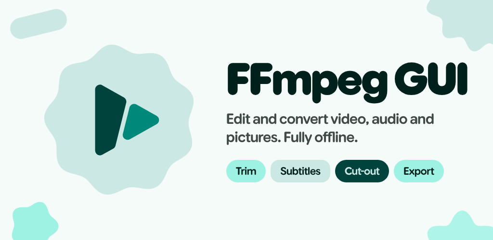
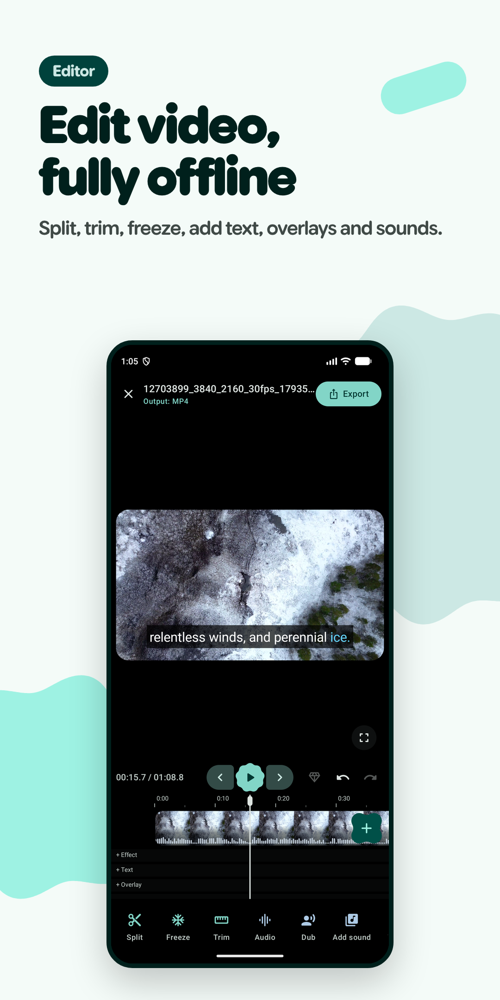
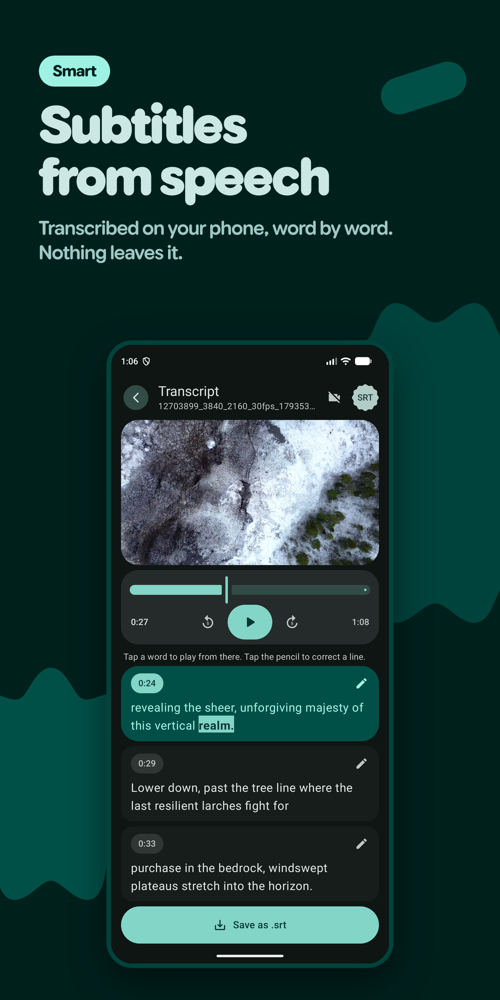
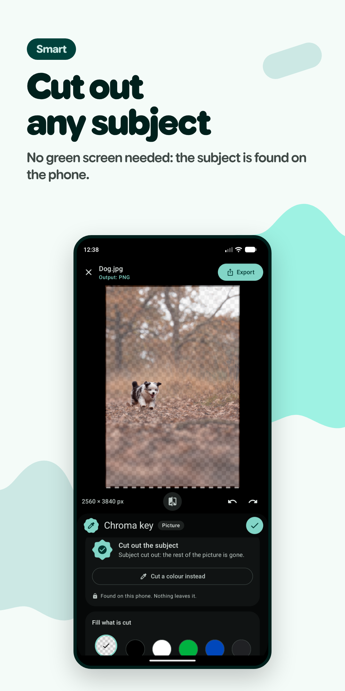
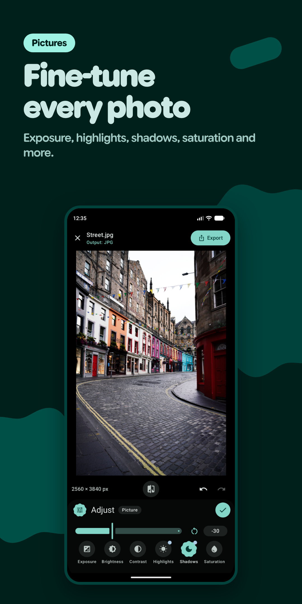
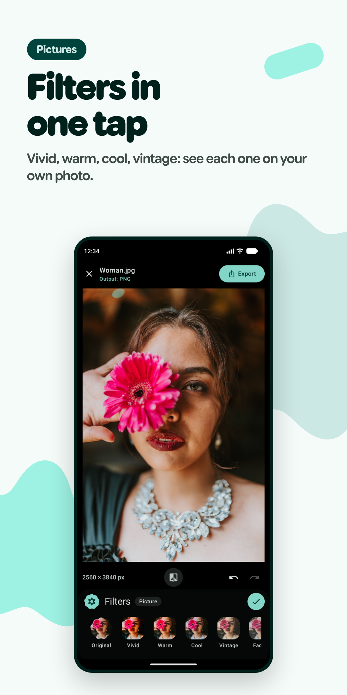
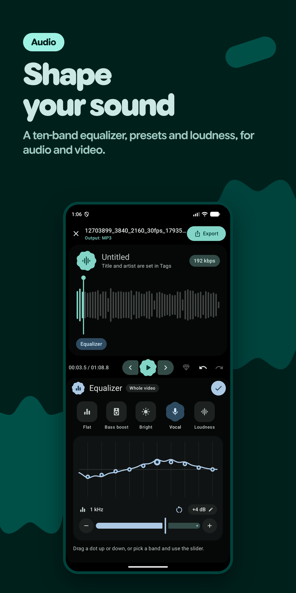

<p align="center">
  
</p>

<p align="center">
  <b>The power of FFmpeg, in a Material 3 Expressive app.</b><br>
  Edit and convert video, audio and pictures on your phone, with a live preview of every change. Fully offline.
</p>

<p align="center">
  
  
  
  
  
</p>

<p align="center">
  <a href="https://ko-fi.com/marcomorosi"></a>
</p>

<p align="center">
  <a href="https://github.com/marcomorosi06/FFmpegGUI/releases"></a>
</p>

<p align="center">
  <a href="https://apps.obtainium.imranr.dev/redirect?r=obtainium://app/%7B%22id%22%3A%22com.cuscus.ffmpeggui%22%2C%22url%22%3A%22https%3A%2F%2Fgithub.com%2Fmarcomorosi06%2FFFmpegGUI%22%2C%22author%22%3A%22marcomorosi06%22%2C%22name%22%3A%22FFmpeg%20GUI%22%2C%22additionalSettings%22%3A%22%7B%5C%22includePrereleases%5C%22%3Afalse%7D%22%7D"></a>
  <a href="https://apps.obtainium.imranr.dev/redirect?r=obtainium://app/%7B%22id%22%3A%22com.cuscus.ffmpeggui%22%2C%22url%22%3A%22https%3A%2F%2Fgithub.com%2Fmarcomorosi06%2FFFmpegGUI%22%2C%22author%22%3A%22marcomorosi06%22%2C%22name%22%3A%22FFmpeg%20GUI%22%2C%22additionalSettings%22%3A%22%7B%5C%22includePrereleases%5C%22%3Atrue%7D%22%7D"></a>
</p>

<p align="center">
  <sub>With <a href="https://github.com/ImranR98/Obtainium">Obtainium</a> installed, a tap adds the app and keeps it updated from the releases here: the first button follows only stable releases, the second one also takes the pre-releases.</sub><br>
  <sub>There is no stable release yet: for now the first button downloads nothing, but it sets the app up in Obtainium, which downloads it by itself as soon as the first stable release is out.</sub>
</p>

---

<table>
  <tr>
    <td></td>
    <td></td>
    <td></td>
  </tr>
  <tr>
    <td></td>
    <td></td>
    <td></td>
  </tr>
</table>

## Development transparency
AI tools were extensively used during development. System architecture, technical decisions, code review, and verification were handled by a human.

Don't trust AI-generated code? Verify it yourself or don't install it at all.

## Why FFmpeg GUI

- **Private by design.** No internet, storage, media, camera or microphone permission: files come only through the system's picker or a share. No ads, no trackers, no account.
- **What you see is what you get.** Every edit shows live in the preview, which runs ports of the same FFmpeg filters the export uses.
- **FFmpeg, not a black box.** The generated command is always in view: edit it by hand, or write your own with suggestions, docs at the cursor and recipes.
- **Made for the phone.** Hardware video encoding, background exports and a full Material 3 Expressive interface, laid out for phones, tablets and monitors.

## Features

| Editor | What it does |
|---|---|
| **Video** | Timeline of clips, speed curves, 101 transitions, keyframes, texts, overlays, effects, chroma key, denoise, subtitles, HDR |
| **Smart features** | Subtitles from speech, transcripts, subject cut-out (and a long press that lifts a subject off a photo), translation, AI dubbing, voice separation, magic eraser |
| **Audio** | Waveform editor, ten-band equaliser, compressor, reverb and more, loudness levelling, tags and cover art |
| **Pictures** | Photo editor, crop and perspective, filters, layers, shapes and blend modes, SVG editor, Ultra HDR JPG |
| **GIF** | Its own editor, with a preview that shows colours and dithering as they will be |

The smart features run entirely on the phone. Their models are not in the app: the browser downloads them once, and the app imports them and checks them against pinned SHA-256 hashes. Each one, with its licence and source: [docs/MODELS.md](docs/MODELS.md).

**[All the features, in detail](docs/FEATURES.md)**

## Formats

| Kind | Formats |
|---|---|
| Video | MP4, MKV, AVI, GIF |
| Audio | MP3, M4A (AAC), OGG (Vorbis), OPUS, FLAC, WAV |
| Pictures | JPG, PNG, WEBP, BMP, TIFF, SVG |
| Anything else | Stream copy, or any FFmpeg command you write |

## Marked as made with AI

When a file holds what an AI model made (a dub's voice, a picture the magic eraser changed), FFmpeg GUI says so inside it, in a form programs can read and detect, as the EU AI Act asks ([Regulation (EU) 2024/1689](https://eur-lex.europa.eu/eli/reg/2024/1689/oj), Article 50(2)).

**A mark that cannot be seen or heard**, in the sound and the picture themselves: [AudioSeal](https://github.com/facebookresearch/audioseal) (Meta, MIT) on every voice a model says, [TrustMark](https://github.com/adobe/trustmark) (Adobe, MIT) on every picture the magic eraser changes, written as they are made and read back before they are kept; what was made before them gets them at export. It holds through compression and resizing. Their files are imported before any other model: without them no model can be imported, and none stays on the phone.

**And the metadata**: IPTC's [Digital Source Type](https://cv.iptc.org/newscodes/digitalsourcetype/) in the file's XMP, and tags of its own (`AI_GENERATED`, `DIGITAL_SOURCE_TYPE`) where the format has them. The marks are written after FFmpeg, so neither the metadata settings nor a command written by hand can leave them out; a format with no place for them (BMP, for example) is not written. Subtitles, transcripts, translations, subject cut-outs and voice separation are not marked: they do not make anything that passes for real.

The marks say only that ("AI-generated voice", "AI-generated inpainting"; the invisible marks carry a payload of zeros): not which model or voice, not which app, no date, nothing about you or your phone, nothing random. They are the same in every file of every user: **no fingerprint of any kind**, they cannot tell one file, phone or person from another.

**Please do not remove these marks** from the files you share: they tell people what was not recorded.

## Security

FFmpeg GUI is in alpha, and its FFmpeg runtime is due for an update: some of the libraries it bundles are older than their fixed releases. What that means, what is already in place, and how to report a vulnerability privately: **[SECURITY.md](SECURITY.md)**.

## Requirements

- Android 10 (API 29) or higher
- arm64-v8a or x86_64 (64-bit only, as the FFmpeg runtime)

## Build

You need JDK 17 or newer, the Android SDK, `git` and `bash`.

```bash
git clone https://github.com/marcomorosi06/FFmpegGUI
cd FFmpegGUI
./scripts/fetch-sherpa-onnx.sh     # speech recognition AAR, if app/libs does not have it
./scripts/fetch-ffmpeg-kit-next.sh # the pinned FFmpeg runtime, checked by its SHA-256
./gradlew assembleDebug            # APK in app/build/outputs/apk/debug/
```

Building FFmpeg yourself, troubleshooting and the reproducible release process: **[Building and releasing](docs/BUILDING.md)**.

## Architecture

Three Gradle modules, with dependencies pointing one way (`app -> media -> core`):

- **`:core`**: pure Kotlin. Request model, FFmpeg command generation, output naming, the conversion workflow and the CPU ports of the filters used by the preview, all unit tested without Android.
- **`:media`**: Android implementations of the interfaces `:core` asks for: the FFmpeg runtime, media probing, file staging, fonts.
- **`:app`**: Compose UI, `ConversionViewModel`, the smart features and the dependency wiring.

Details, data flow and a "where do I change X" table are in [`docs/ARCHITECTURE.md`](docs/ARCHITECTURE.md).

> Video stabilisation is implemented in the backend but has no editor controls yet.

### Libraries

| Library | Version | Purpose |
|---|---|---|
| FFmpegKitNext (built from source) | 6.1.1 | FFmpeg engine (FFmpeg 6.1.6) |
| Jetpack Compose + Material 3 | BOM 2026.09.00 (Compose 1.12.1), Material 3 1.5.0-beta01 | UI |
| Navigation Compose | 2.9.8 | Screen navigation |
| Media3 ExoPlayer | 1.10.1 | Media preview |
| AndroidX Core Splashscreen | 1.2.0 | Splash screen |
| sherpa-onnx (with ONNX Runtime) | 1.13.8 | Speech recognition (release AAR in `app/libs`) |
| ONNX Runtime (Java API) | 1.28.0 | Subject cut-out |
| AndroidSVG | 1.4 | Opening SVG files, drawing parts of SVGs in the SVG editor |

## Star history

<a href="https://www.star-history.com/#marcomorosi06/FFmpegGUI&Date">
  <picture>
    <source media="(prefers-color-scheme: dark)" srcset="https://api.star-history.com/svg?repos=marcomorosi06/FFmpegGUI&type=Date&theme=dark&transparent=true">
    
  </picture>
</a>

## Support the project

FFmpeg GUI is made by one person, in spare time, and will stay free and open source. If it is useful to you, you can buy me a coffee on [Ko-fi](https://ko-fi.com/marcomorosi): it keeps the project going.

## Credits

- [FFmpeg](https://ffmpeg.org) (LGPL 2.1+ / GPL 2+), through [FFmpegKitNext](https://github.com/arthenica/ffmpeg-kit-next) (GPL 3.0 with the GPL libraries), built with:
  - [x264](https://www.videolan.org/developers/x264.html), [x265](https://www.x265.org), [Xvid](https://www.xvid.com) and [vid.stab](https://github.com/georgmartius/vid.stab) (GPL 2+)
  - [LAME](https://lame.sourceforge.io), [FriBidi](https://github.com/fribidi/fribidi) and libiconv (LGPL)
  - libass, dav1d, FreeType, HarfBuzz, Fontconfig, Opus, Vorbis, Ogg, zimg, Expat, libpng and cpu_features (permissive licences)
- [sherpa-onnx](https://github.com/k2-fsa/sherpa-onnx) (Apache 2.0, with [eSpeak NG](https://github.com/espeak-ng/espeak-ng), GPL 3.0 or later, inside it; repacked as described in `app/src/main/assets/licenses/ffmpeg-gui/NOTICE.txt`) and [ONNX Runtime](https://onnxruntime.ai) (MIT)
- [Jetpack Compose](https://developer.android.com/compose), [AndroidX](https://developer.android.com/jetpack/androidx) and [Media3](https://developer.android.com/media/media3) (Apache 2.0)
- [AndroidSVG](https://github.com/BigBadaboom/androidsvg) by Cave Rock Software (Apache 2.0)
- [Okio](https://github.com/square/okio) by Square and [kotlinx.serialization](https://github.com/Kotlin/kotlinx.serialization) by JetBrains (Apache 2.0), used by AndroidX
- [Parakeet TDT 0.6B v3](https://huggingface.co/nvidia/parakeet-tdt-0.6b-v3) by NVIDIA (CC BY 4.0), downloaded by the user; its token list ships with the app
- [IS-Net](https://github.com/xuebinqin/DIS) and [U2-Net](https://github.com/xuebinqin/U-2-Net) by Xuebin Qin et al. (Apache 2.0), as converted by [rembg](https://github.com/danielgatis/rembg) (MIT)
- [BiRefNet](https://github.com/ZhengPeng7/BiRefNet) by Zheng Peng et al. (MIT), its lite general-use weights, converted to ONNX by this project (`scripts/export-birefnet.py`) and served from its [releases](https://github.com/marcomorosi06/FFmpegGUI/releases/tag/birefnet-lite-onnx-1) with its licence and notice, downloaded by the user
- [Opus-MT](https://github.com/Helsinki-NLP/Opus-MT) by the University of Helsinki (CC BY 4.0), as converted to ONNX by [Xenova](https://huggingface.co/Xenova), downloaded by the user
- [Spleeter](https://github.com/deezer/spleeter) by Deezer (MIT), as converted to ONNX and quantised by [sherpa-onnx](https://k2-fsa.github.io/sherpa/onnx/source-separation/models.html), downloaded by the user; its spectrogram and masks are computed as sherpa-onnx does, in the app's own Kotlin
- [Kokoro-82M](https://huggingface.co/hexgrad/Kokoro-82M) by hexgrad (Apache 2.0), in the multi-language build of [sherpa-onnx](https://github.com/k2-fsa/sherpa-onnx/releases/tag/tts-models), with [eSpeak NG](https://github.com/espeak-ng/espeak-ng)'s data (GPL 3.0), downloaded by the user
- [Piper](https://github.com/rhasspy/piper) voices (the format: MIT; each voice under its own licence, see its card), as published on [Hugging Face](https://huggingface.co/rhasspy/piper-voices) or packed by [sherpa-onnx](https://github.com/k2-fsa/sherpa-onnx/releases/tag/tts-models), downloaded by the user
- [MI-GAN](https://github.com/Picsart-AI-Research/MI-GAN) by Picsart AI Research (MIT) and [LaMa](https://github.com/advimman/lama) by Samsung AI Center (Apache 2.0, ONNX by [Carve](https://huggingface.co/Carve/LaMa-ONNX)), downloaded by the user
- [EdgeTAM](https://github.com/facebookresearch/EdgeTAM) by Meta (Apache 2.0), a [Segment Anything 2](https://github.com/facebookresearch/sam2) for phones, converted to ONNX by this project (`scripts/export-edgetam.py`; what changed is in its NOTICE) and served from its [releases](https://github.com/marcomorosi06/FFmpegGUI/releases/tag/edgetam-onnx-1), downloaded by the user
- [anti-vocale](https://github.com/RisorseArtificiali/anti-vocale) (Apache 2.0), where the idea of on-device transcription and the way to run the model come from
- [Google Sans Flex](https://fonts.google.com/specimen/Google+Sans+Flex) (SIL Open Font License)
- [AudioSeal](https://github.com/facebookresearch/audioseal) by Meta (MIT, the weights included), converted to ONNX by this project (`scripts/export-ai-markers.py`), and [TrustMark](https://github.com/adobe/trustmark) by Adobe (MIT, the model files included; T. Bui, S. Agarwal, J. Collomosse, ICCV 2025), Adobe's ONNX files unchanged ([redistribution confirmed](https://github.com/adobe/trustmark/issues/48)): the AI marks, served from this repository's [releases](https://github.com/marcomorosi06/FFmpegGUI/releases/tag/ai-markers-1) with their licences and NOTICE, downloaded by the user
- Two identifiers of IPTC's [Digital Source Type](https://cv.iptc.org/newscodes/digitalsourcetype/) vocabulary (CC BY 4.0), in the AI marks of exported files
- The [Obtainium](https://github.com/ImranR98/Obtainium) logo by ImranR98 (GPL 3.0), in this page's Obtainium buttons only ([its licence](docs/badges/LICENSE-obtainium-logo.txt))
- The photos and the video inside the store screenshots, from [Pexels](https://www.pexels.com/license/) (free to use, no attribution required): [winter forest](https://www.pexels.com/video/aerial-winter-landscape-over-forest-and-snow-29513356/), [gerbera](https://www.pexels.com/photo/elegant-woman-with-pink-gerbera-flower-39296598/), [Victoria Street](https://www.pexels.com/it-it/foto/la-pittoresca-victoria-street-di-edimburgo-in-scozia-39767336/), [puppy](https://www.pexels.com/photo/adorable-puppy-running-through-autumn-leaves-34928384/); not part of the app ([credits](fastlane/metadata/android/en-US/images/CREDITS.txt))

The splash screen comes from [WiFi Audio Streaming for Android](https://github.com/marcomorosi06/WiFiAudioStreaming-Android), by the same author and under the same licence (EUPL 1.2).

The video effects are made by the project's own `scripts/generate-effects.py` (the punches' 3D fist and the sound of its blow by `scripts/punch3d.py`, the math formulas by `scripts/math_effect.py` with its own stroke font, the TV break's test card and tune by `scripts/tv_break.py`) and are part of FFmpeg GUI, under its licence.

Each component stays under its own licence.

**The AI models** are recorded one by one in [docs/MODELS.md](docs/MODELS.md): who made each, its licence, where its files come from, the SHA-256 the app checks them against and what it was trained on, and how the licences of the two models this project converts and serves itself are kept. `scripts/check-model-pins.py` checks, before every release, that the app, the record and the licences agree. It is a record, not legal advice.

## License

Copyright (c) 2026 Marco Morosi.

The source code of FFmpeg GUI is licensed under the [EUPL v1.2](LICENSE), which is available in all the official languages of the EU, each version equally valid.

The APK also contains FFmpeg built with GPL libraries (x264, x265, Xvid, vid.stab), eSpeak NG (GPL 3.0 or later, inside sherpa-onnx's `libsherpa-onnx-jni.so`) and other third-party components (see Credits). As allowed by Article 5 of the EUPL (compatibility clause), the APK as a whole is distributed under the [GNU GPL v3](https://www.gnu.org/licenses/gpl-3.0.html). Each third-party component stays under its own licence.

FFmpeg GUI is provided "as is", without any warranty, to the extent permitted by law.
