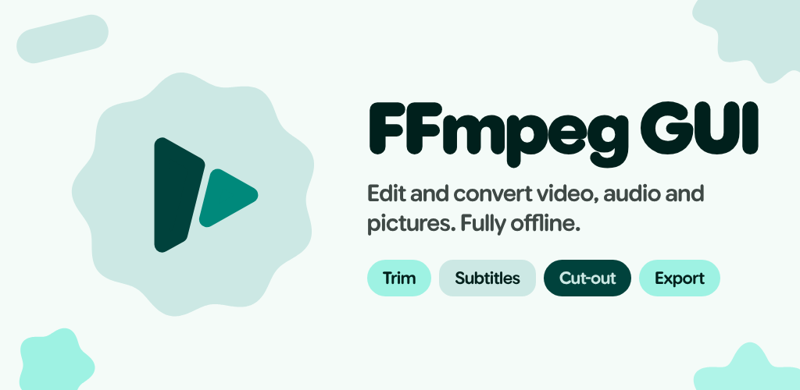
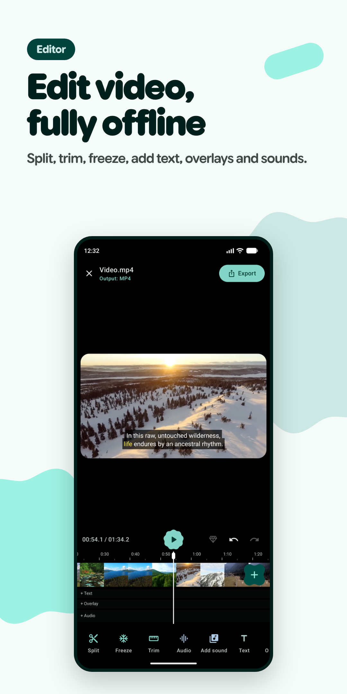
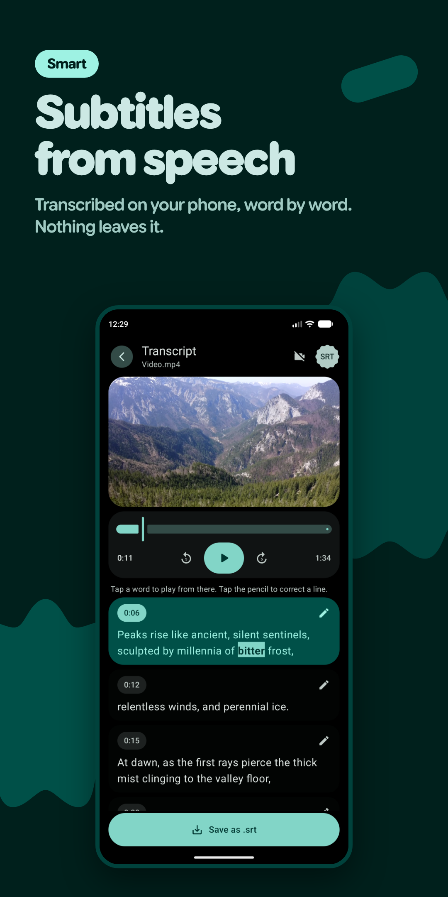
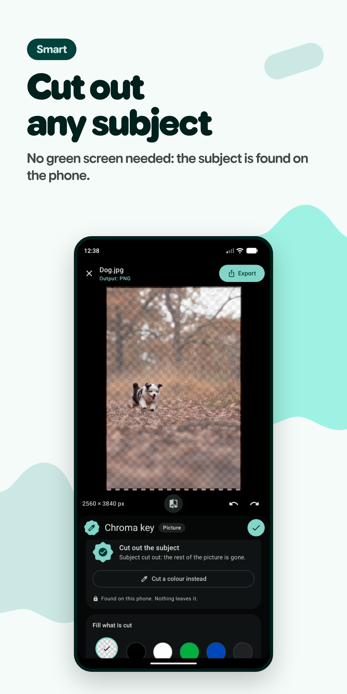
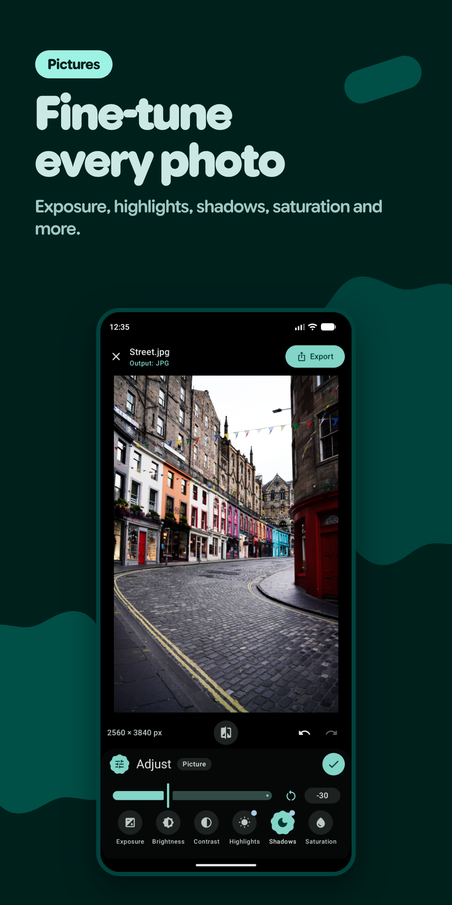
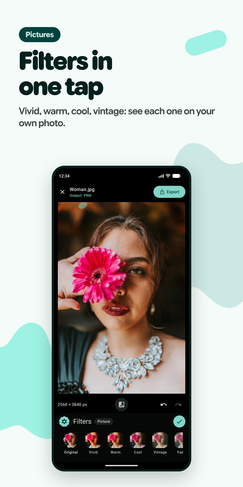
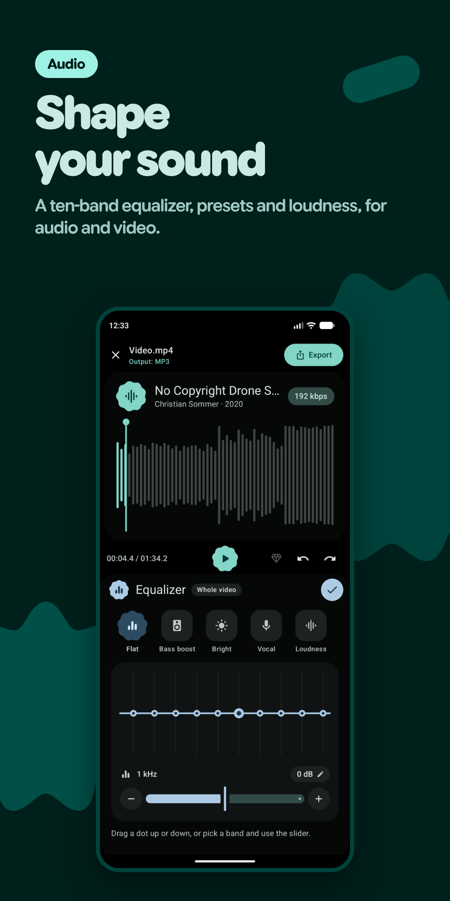

<p align="center">
  
</p>

<p align="center">
  <b>The power of FFmpeg, in a Material 3 Expressive app.</b><br>
  Edit and convert video, audio and pictures on your phone, with a live preview of every change. Fully offline.
</p>

<p align="center">
  
  
  
  
  
</p>

<p align="center">
  <a href="https://ko-fi.com/marcomorosi"></a>
</p>

<p align="center">
  <a href="https://github.com/marcomorosi06/FFmpegGUI/releases"></a>
</p>

---

<table>
  <tr>
    <td></td>
    <td></td>
    <td></td>
  </tr>
  <tr>
    <td></td>
    <td></td>
    <td></td>
  </tr>
</table>

## Why FFmpeg GUI

- **Private by design.** The app has no internet permission, and no storage, media, camera or microphone permission either: files come only through the system's picker or a share, one at a time. The build fails if a dependency ever tries to add one of them. No ads, no trackers, no account: nothing you open leaves the phone.
- **What you see is what you get.** Every edit shows in the editor before anything is rendered. The preview runs ports of the same FFmpeg filters the export uses, so the file comes out as you saw it.
- **FFmpeg, not a black box.** The generated command is always in view and can be edited by hand before converting, or replaced by your own.
- **Made for the phone.** Video is encoded by the phone's own video chip, exports keep running in the background, and the whole interface follows Material 3 Expressive: springy motion, shape-morphing controls, colours from your wallpaper or the app's own teal. Every screen also lays itself out for a phone on its side, a tablet or a monitor: two panes side by side, and in the editors the timeline across the bottom with a tool's panel beside the preview.

## Features

### Video
- A timeline of clips from one or more files: split, trim by dragging, reorder, duplicate, freeze frames, pictures as clips with Ken Burns motion
- Speed (with automatic `atempo` chaining) or a **speed curve** drawn along a clip, with ready-made ramps (montage, hero, bullet, flash in / out...), the pitch kept or following the speed like a tape; reverse, crop and aspect ratio, rotation, mirror, resolution and frame rate
- **Transitions** between clips, as in CapCut: 25 of them (dissolves, dips to black or white, slides, covers, reveals, wipes, soft wipes, circles, iris, box, doors, shutter, clock, zoom), each with its own length; every choice plays in a loop on its tile, the joins between clips are buttons on the timeline, and the preview draws them live with the same math as the export (`xfade` and `acrossfade`)
- Colour, fades and **keyframes**: clips zoom, pan and change colour and volume; texts and pictures move, grow, turn and fade; each keyframe moves on to the next with an easing (linear, smooth, ease in / out, overshoot, bounce, elastic, hold) or a curve drawn by hand
- **Texts** and **pictures or videos laid over the video**, each on its own row of the timeline: crop, rounded or round shape, outline, shadow or glow, blur, layers and ready-made animations in and out
- **Chroma key and colour key** on clips, the whole video and overlays, with spill removal and transparency
- **Sounds** on their own rows, with their real waveform: volume, speed (keeping the pitch or not), pitch shift, fades, equaliser, repeat
- Burned-in subtitles (`.srt`, `.ass`), undo and redo of every edit
- HDR videos (HDR10, HLG) are tone mapped to SDR for the export (`zscale`, `tonemap`), so that their colours come out right instead of washed out
- **HDR look for SDR videos**, as for photos: the light parts shine brighter than white, saved as a real HDR video (HLG, BT.2020, HEVC Main 10, through a 3D LUT with `lut3d`). The preview tints the zones it brightens, live; on an HDR screen the frame under the playhead shows as it will be

### Smart features, on the phone
- **Subtitles from speech**: the video is listened to on the phone (25 European languages) and the words appear on the preview as they are found. Presets, colours, outline or box, the word being said lit up, lines to correct, export as `.srt`
- **Transcripts**: any audio or video file written down as `.txt` or `.srt`, read beside the player and corrected line by line
- **Subject cut-out** without a green screen, on photos, stickers and pictures laid over the video; FFmpeg merges the mask in (`movie`, `alphamerge`)
- **Cut-out corrected with two brushes**, as in a magic editor: green keeps, red removes. With the magic tool a tap or a rough stroke is enough: a light Segment Anything finds the whole thing, only what the stroke touches is taken and its edge is brought to the picture's own edges (guided filter). The precise brush changes exactly what it covers; two fingers zoom in for the fine parts; undo and redo stroke by stroke

The models are not in the app and are never downloaded by it: the browser downloads them once, the app imports them and checks every file against its pinned SHA-256 (Settings > Smart features). Two models are offered for each feature:

| Feature | Model | Notes |
|---|---|---|
| Speech | Parakeet TDT 0.6B v3, int8 (sherpa-onnx) | Lighter |
| Speech | Parakeet TDT 0.6B v3, SmoothQuant | Best quality, a little heavier |
| Cut-out | U2-NetP | Fast, about 5 MB |
| Cut-out | IS-Net (general use) | Precise, about 170 MB |
| Cut-out correction | SlimSAM-77 (ONNX by Xenova) | Optional, about 40 MB |

### Audio
- A dedicated editor with a large waveform of the exported sound, heard live as you edit
- Ten-band equaliser with a draggable curve and presets; low and high cut, noise gate, compressor, limiter; echo and reverb; chorus, flanger, phaser, tremolo, vibrato; bit crushing; stereo width, balance, mono
- Loudness levelling (`loudnorm`), silence trimming, splitting into parts
- Tags and cover art, written into MP3, M4A, FLAC, OGG and OPUS
- Bitrate, bit depth and sample rate per format

### Pictures
- A photo editor for any picture or any frame of a video. The exact frame is chosen first on a screen of its own: a strip of the video's frames, a wheel that ticks at every frame and spins on when thrown, one or ten frames at a time, two fingers to look closely
- **Every frame in a ZIP**: at the file's own rate or fewer a second, over the whole clip or a part, in the picture format chosen
- Crop with locked shapes, straighten, perspective
- Exposure, brightness, contrast, highlights, shadows, warmth, tint, hue and more
- Twelve filters with intensity and effects (blur, pixels, glitch, duotone, sketch...)
- Texts, stickers, drawing and borders
- Background removal by colour or by subject, kept transparent in PNG, WEBP and TIFF
- **HDR look, saved as an Ultra HDR JPG** (the picture plus a gain map, readable by every viewer, brighter on HDR screens): worked out of the picture's light or, for an Ultra HDR photo, the camera's own, with its intensity, everywhere, on the subject, on the background or where it is painted. On an HDR screen (Android 14 and later) the editor shows it as it will be; on any screen it can tint the zones it brightens. Texts, stickers, the drawing and the border are left as they are

### GIF
- Its own editor and settings: width, frame rate, colours, dithering, loops, lighter file
- The preview plays the GIF as it will be, colours and dithering included

### Around the editors
- Opens or receives (Share) any supported video, audio or picture from other apps
- Recent projects, kept only on the phone
- Export progress in a notification, a Live Update on Android 16, with time left and cancel
- Background playback of the preview, with media notification and lock-screen controls
- A welcome tour that sets theme, colours, touch feedback and exports on the first launch

## Formats

| Kind | Formats |
|---|---|
| Video | MP4, MKV, AVI, GIF |
| Audio | MP3, M4A (AAC), OGG (Vorbis), OPUS, FLAC, WAV |
| Pictures | JPG, PNG, WEBP, BMP, TIFF |
| Anything else | Stream copy, or any FFmpeg command you write |

## Requirements

- Android 10 (API 29) or higher
- arm64-v8a or x86_64 (64-bit only, as the FFmpeg runtime)

## Build

The project uses Gradle with a version catalog (`gradle/libs.versions.toml`): AGP 9.1, Gradle 9.3.1, JDK 17, compileSdk 37. It opens in Android Studio Panda 2 (2025.3.2) or newer.

FFmpeg comes from [FFmpegKitNext](https://github.com/arthenica/ffmpeg-kit-next), which publishes source only. Its AAR is built from the commits pinned in `scripts/ffmpeg-kit-next.lock` by a workflow that builds it twice, on two different runners, and publishes it only when both builds are byte-identical; `scripts/ffmpeg-kit-next-aar.txt` pins that AAR by its SHA-256, and the Gradle build takes no other. You can download it (no extra tools) or build it yourself with [Nix](https://github.com/arthenica/ffmpeg-kit-next/wiki/Nix) and check that you get the same file. See [`docs/ARCHITECTURE.md`](docs/ARCHITECTURE.md), "FFmpeg runtime".

### What you need

- JDK 17 or newer and the Android SDK. Android Studio installs both; on the command line, point `ANDROID_HOME` (or `sdk.dir` in `local.properties`) at the SDK.
- `git` and `bash`.
- Only to build FFmpeg yourself: Nix, on Linux x86_64 (any distribution except NixOS) or macOS, and several GB of free disk space.

### 1. Get the sources

```bash
git clone https://github.com/marcomorosi06/FFmpegGUI
cd FFmpegGUI
./scripts/fetch-sherpa-onnx.sh   # the speech recognition AAR, if app/libs does not have it
```

### 2. Get FFmpeg

```bash
./scripts/fetch-ffmpeg-kit-next.sh
```

It downloads the AAR pinned in `scripts/ffmpeg-kit-next-aar.txt` into `media/libs/` and checks its SHA-256. To build it yourself instead, see "Building FFmpeg yourself" below.

### 3. Build the app

```bash
./gradlew assembleDebug     # APK in app/build/outputs/apk/debug/
./gradlew installDebug      # or install it on a connected phone (it sits next to a release install)
./gradlew :core:test        # backend unit tests, plain JVM
```

`./gradlew assembleRelease` makes an unsigned APK in `app/build/outputs/apk/release/`, to sign with your own key (`apksigner`; see "Releasing"). In Android Studio, open the project folder after step 2 and run the `app` configuration.

### Building FFmpeg yourself

Install Nix once. On Fedora 44 or newer, Nix is in the official repositories:

```bash
sudo dnf install nix nix-daemon
sudo systemctl enable --now nix-daemon
```

On other Linux distributions with systemd, and on macOS, use the multi-user installer from [nixos.org/download](https://nixos.org/download/):

```bash
sh <(curl --proto '=https' --tlsv1.2 -L https://nixos.org/nix/install) --daemon
```

Then open a new terminal and check it:

```bash
nix --version
nix-shell -p hello --run hello   # optional: downloads a few packages the first time, then prints "Hello, world!"
```

Nothing else needs configuring: the build script turns on the Nix features it uses (flakes) by itself.

Then build it:

```bash
./scripts/build-ffmpeg-kit-next.sh
```

The first run can take an hour or more. The script:

1. clones FFmpegKitNext and the sources it needs into the work folder and checks that each one is the commit pinned in `scripts/ffmpeg-kit-next.lock`, before anything is compiled;
2. builds FFmpeg and FFmpegKitNext in a Nix shell (toolchain pinned by FFmpegKitNext's `flake.lock`), for arm64-v8a and x86_64;
3. packs the AAR with Gradle, whose distribution must have the SHA-256 in the lock and whose plugins and libraries must match `scripts/ffmpeg-kit-next.verification-metadata.xml`;
4. checks every source again and only then writes `media/libs/ffmpeg-kit-next-6.1.1.aar`, with `ffmpeg-kit-next-6.1.1.provenance.txt` beside it (its SHA-256, the commits and the options used), and says whether it is the pinned AAR.

The work folder is `.ffmpeg-kit-next/` in the project (ignored by git). The AAR records the work folder's path, so to rebuild the published AAR byte for byte use the folder it was built in:

```bash
FFMPEG_KIT_WORKDIR=/var/tmp/ffmpeg-kit-next ./scripts/build-ffmpeg-kit-next.sh
```

An AAR that is not the pinned one is refused by Gradle; for local experiments, build with `-Pffmpeg.unpinned=true` (never for a release).

`scripts/ffmpeg-kit-next.verification-metadata.xml` is kept in the repository. If it is not there yet (or FFmpegKitNext moved to other Gradle plugins), make it once, read it and commit it:

```bash
./scripts/build-ffmpeg-kit-next.sh --write-gradle-verification
```

It records the SHA-256 of everything Gradle downloads at that moment, and from then on Gradle refuses anything else. Run it on each kind of computer you build on (Linux, macOS): entries already in the file are kept, and the Android plugin downloads a different `aapt2` on each.

Later runs reuse the checked sources. `--clean` starts from an empty work folder, `--help` lists the options. To add a library the app does not use by default (for hand-written commands), pass it after `--`, for example `./scripts/build-ffmpeg-kit-next.sh -- --enable-libvpx`: its source is checked against the lock like the others.

### Troubleshooting

| Message | What to do |
|---|---|
| `media/libs/ffmpeg-kit-next-6.1.1.aar is missing` or `Could not find com.arthenica:ffmpeg-kit-next` | Get FFmpeg first (step 2). |
| `No AAR is pinned in scripts/ffmpeg-kit-next-aar.txt yet` | None is published yet: build it yourself, or let the "FFmpeg runtime (AAR)" workflow publish and pin it (see "Releasing"). |
| `The FFmpeg runtime pinned in ... was built from other inputs` | The lock, the build script or the Gradle verification file changed after the AAR was pinned: wait for the "FFmpeg runtime (AAR)" workflow to pin the new one, then tag again. |
| `... is not the pinned FFmpeg runtime` | `media/libs` holds another AAR: run `./scripts/fetch-ffmpeg-kit-next.sh`, or build with `-Pffmpeg.unpinned=true` to use your own (never for a release). |
| `error: Nix is needed` | Install Nix (see "Building FFmpeg yourself"), then open a new terminal. |
| `... the lock says ...: its source changed` | A source online is no longer the pinned commit. Do not edit the lock to get past it: the check exists for this case. Open an issue. |
| `ffmpeg-kit-next.verification-metadata.xml is missing` | Make it once with `--write-gradle-verification`, read it and commit it. |
| `Dependency verification failed` in `build.log` | Gradle downloaded something that differs from `scripts/ffmpeg-kit-next.verification-metadata.xml`. If it is a file of another host (Linux / macOS), run `--write-gradle-verification` there; otherwise do not regenerate the file to get past it. |
| `the build failed` | The details are in `build.log`, in the `ffmpeg-kit-next` folder of the work folder. |
| `refusing to use ... as the work folder` | `FFMPEG_KIT_WORKDIR` points at a folder that is not the script's (the project, your home, a folder with other files). Point it at a new or empty folder, or leave it unset. |
| `... everything built from it was deleted` | A source changed during the build. Run the script again: it fetches the pinned commit and builds everything anew. |

The script ignores the variables of your shell (only the ones listed in `KEEP_ENV`, at the top of the script, reach the build), so a variable left over from an experiment cannot change what is built. Each build starts from sources put back exactly as their pinned commits; libraries built earlier are only reused when sources, lock, options and script are all the same.

Once the AAR is in `media/libs`, the work folder can be deleted to free space (it is only needed to build FFmpeg again), and `nix-collect-garbage -d` removes what Nix downloaded.

### Releasing

Releases are reproducible: [IzzyOnDroid](https://izzyondroid.org/docs/reproducibleBuilds/)'s builder rebuilds the APK from the tag and compares it with the published one, byte for byte. The release key never leaves your machine.

1. **Tag.** `git tag v1.0 && git push origin v1.0`. The *Reproducible APK* workflow builds the unsigned APK in IzzyOnDroid's environment (Debian bookworm, OpenJDK 17, the pinned FFmpeg runtime), has IzzyOnDroid's own builder ([rbtlog](https://codeberg.org/IzzyOnDroid/rbtlog)) rebuild it from `.github/izzyondroid/`, and only if both are byte-identical leaves the APK in a **draft** release of `v1.0` (a pre-release for tags such as `v1.0-beta1`). Otherwise there is a diffoscope report and no draft.
2. **Sign and publish, on your machine.** Download `ffmpeg-gui-v1.0-unsigned.apk` from the draft (its SHA-256 is in the draft's notes) and sign it without re-aligning it, so the signed APK is that exact file plus the signature:

   ```bash
   apksigner sign --alignment-preserved true --v1-signing-enabled false \
     --ks ~/keystores/ffmpeggui-release.jks \
     --out ffmpeg-gui-v1.0.apk ffmpeg-gui-v1.0-unsigned.apk
   ```

   Attach `ffmpeg-gui-v1.0.apk` to the draft (the IzzyOnDroid recipe looks for that name), delete the unsigned APK from it and publish the release. Leave `ffmpeg-gui-v1.0-source.tar.xz` in it: it is the complete source of the APK (the app, FFmpegKitNext with every library the FFmpeg runtime is built from, sherpa-onnx with its dependencies), packed by `scripts/package-sources.sh`, which the GPL-3.0 asks to keep available next to the APK. Signing any other way (Android Studio, or `apksigner` without `--alignment-preserved true`) gives an APK IzzyOnDroid cannot reproduce.
3. **Check.** Publishing starts *Verify published release*: rbtlog downloads the published APK and repeats IzzyOnDroid's whole check.

**The FFmpeg runtime follows by itself.** After a push to `master` that changes `scripts/ffmpeg-kit-next.lock`, `scripts/build-ffmpeg-kit-next.sh` or the Gradle verification file, the *FFmpeg runtime (AAR)* workflow builds the AAR twice (it takes hours), publishes it as a pre-release if both builds match, and commits the new pin to `scripts/ffmpeg-kit-next-aar.txt` (`git pull` afterwards). If `master` is protected, it cannot push: its summary gives the three lines to commit. A tag pushed before the pin is refused (the pinned AAR was built from other inputs): delete it, wait for the pin, and tag again.

**IzzyOnDroid.** To have the app verified there, send them `.github/izzyondroid/com.cuscus.ffmpeggui.yml`, once: their server follows new releases by itself.

| Library | Version | Purpose |
|---|---|---|
| FFmpegKitNext (built from source) | 6.1.1 | FFmpeg engine (FFmpeg 6.1.6) |
| Jetpack Compose + Material 3 | BOM 2026.06.01 | UI |
| Navigation Compose | 2.9.8 | Screen navigation |
| Media3 ExoPlayer | 1.10.1 | Media preview |
| AndroidX Core Splashscreen | 1.2.0 | Splash screen |
| sherpa-onnx (with ONNX Runtime) | 1.13.8 | Speech recognition (release AAR in `app/libs`) |
| ONNX Runtime (Java API) | 1.28.0 | Subject cut-out |

## Architecture

Three Gradle modules, with dependencies pointing one way (`app -> media -> core`):

- **`:core`**: pure Kotlin. Request model, FFmpeg command generation, output naming, the conversion workflow and the CPU ports of the filters used by the preview, all unit tested without Android.
- **`:media`**: Android implementations of the interfaces `:core` asks for: the FFmpeg runtime, media probing, file staging, fonts.
- **`:app`**: Compose UI, `ConversionViewModel`, the smart features and the dependency wiring.

Details, data flow and a "where do I change X" table are in [`docs/ARCHITECTURE.md`](docs/ARCHITECTURE.md).

> Video stabilisation and denoising are implemented in the backend but have no editor controls yet.

## Support the project

FFmpeg GUI is made by one person, in spare time, and will stay free and open source. If it is useful to you, you can buy me a coffee on [Ko-fi](https://ko-fi.com/marcomorosi): it keeps the project going.

## Credits

- [FFmpeg](https://ffmpeg.org) (LGPL 2.1+ / GPL 2+), through [FFmpegKitNext](https://github.com/arthenica/ffmpeg-kit-next) (GPL 3.0 with the GPL libraries), built with:
  - [x264](https://www.videolan.org/developers/x264.html), [x265](https://www.x265.org), [Xvid](https://www.xvid.com) and [vid.stab](https://github.com/georgmartius/vid.stab) (GPL 2+)
  - [LAME](https://lame.sourceforge.io), [FriBidi](https://github.com/fribidi/fribidi) and libiconv (LGPL)
  - libass, dav1d, FreeType, HarfBuzz, Fontconfig, Opus, Vorbis, Ogg, zimg, Expat, libpng and cpu_features (permissive licences)
- [sherpa-onnx](https://github.com/k2-fsa/sherpa-onnx) (Apache 2.0) and [ONNX Runtime](https://onnxruntime.ai) (MIT)
- [Jetpack Compose](https://developer.android.com/compose), [AndroidX](https://developer.android.com/jetpack/androidx) and [Media3](https://developer.android.com/media/media3) (Apache 2.0)
- [Parakeet TDT 0.6B v3](https://huggingface.co/nvidia/parakeet-tdt-0.6b-v3) by NVIDIA (CC BY 4.0), downloaded by the user; its token list ships with the app
- [IS-Net](https://github.com/xuebinqin/DIS) and [U2-Net](https://github.com/xuebinqin/U-2-Net) by Xuebin Qin et al. (Apache 2.0), as converted by [rembg](https://github.com/danielgatis/rembg) (MIT)
- [SlimSAM](https://github.com/czg1225/SlimSAM) by Zigeng Chen et al. (Apache 2.0), a pruned [Segment Anything](https://github.com/facebookresearch/segment-anything), as converted to ONNX by [Xenova](https://huggingface.co/Xenova/slimsam-77-uniform)
- [anti-vocale](https://github.com/RisorseArtificiali/anti-vocale) (Apache 2.0), where the idea of on-device transcription and the way to run the model come from
- [Google Sans Flex](https://fonts.google.com/specimen/Google+Sans+Flex) (SIL Open Font License)

Each component stays under its own licence.

## License

Copyright (c) 2026 Marco Morosi.

The source code of FFmpeg GUI is licensed under the [EUPL v1.2](LICENSE), which is available in all the official languages of the EU, each version equally valid.

The APK also contains FFmpeg built with GPL libraries (x264, x265, Xvid, vid.stab) and other third-party components (see Credits). As allowed by Article 5 of the EUPL (compatibility clause), the APK as a whole is distributed under the [GNU GPL v3](https://www.gnu.org/licenses/gpl-3.0.html). Each third-party component stays under its own licence.

FFmpeg GUI is provided "as is", without any warranty, to the extent permitted by law.
